# OfficeOS — Full Entity-Relationship (ER) Diagram

This document contains the complete database Entity-Relationship specification for the multi-tenant Office Management SaaS platform.

## Complete Mermaid ER Diagram

```mermaid
erDiagram
    ORGANIZATIONS ||--o{ PROFILES : "has members via"
    ORGANIZATIONS ||--o{ ORGANIZATION_MEMBERSHIPS : "contains"
    PROFILES ||--o{ ORGANIZATION_MEMBERSHIPS : "belongs to"
    ORGANIZATIONS ||--o{ BRANCHES : "operates"
    ORGANIZATIONS ||--o{ DEPARTMENTS : "contains"
    ORGANIZATIONS ||--o{ EMPLOYEES : "employs"
    ORGANIZATIONS ||--o{ ROLES : "defines"
    ROLES ||--o{ ROLE_PERMISSIONS : "granted"
    PERMISSIONS ||--o{ ROLE_PERMISSIONS : "includes"
    ORGANIZATION_MEMBERSHIPS ||--o{ MEMBERSHIP_ROLES : "assigned"
    ROLES ||--o{ MEMBERSHIP_ROLES : "references"

    BRANCHES ||--o{ EMPLOYEES : "stationed at"
    DEPARTMENTS ||--o{ EMPLOYEES : "assigned to"
    PROFILES ||--o| EMPLOYEES : "linked user"
    ORGANIZATION_MEMBERSHIPS ||--o| EMPLOYEES : "membership ref"

    EMPLOYEES ||--o{ ATTENDANCE_RECORDS : "clocks in/out"
    BRANCHES ||--o{ ATTENDANCE_RECORDS : "location"
    EMPLOYEES ||--o{ LEAVE_REQUESTS : "requests"
    LEAVE_TYPES ||--o{ LEAVE_REQUESTS : "classified under"
    ORGANIZATIONS ||--o{ HOLIDAYS : "observes"

    EMPLOYEES ||--o{ SALARY_STRUCTURES : "baseline pay"
    ORGANIZATIONS ||--o{ PAYROLLS : "runs"
    PAYROLLS ||--o{ PAYSLIPS : "disburses"
    EMPLOYEES ||--o{ PAYSLIPS : "receives"
    ORGANIZATIONS ||--o{ BONUSES : "campaigns"
    BONUSES ||--o{ BONUS_ALLOCATIONS : "allocates"
    EMPLOYEES ||--o{ BONUS_ALLOCATIONS : "awarded to"
    PAYROLLS ||--o{ BONUS_ALLOCATIONS : "included in"
    EMPLOYEES ||--o{ REIMBURSEMENT_CLAIMS : "submits"

    ORGANIZATIONS ||--o{ CLIENTS : "serves"
    CLIENTS ||--o{ CLIENT_CONTACTS : "has contacts"
    CLIENTS ||--o{ PROJECTS : "funds"
    PROJECTS ||--o{ PROJECT_MEMBERS : "staffed by"
    EMPLOYEES ||--o{ PROJECT_MEMBERS : "member"
    PROJECTS ||--o{ CLIENT_ENGAGEMENTS : "formalized as"
    CLIENT_ENGAGEMENTS ||--o{ PROPOSALS : "contains"
    CLIENT_ENGAGEMENTS ||--o{ AGREEMENTS : "signed via"
    AGREEMENTS ||--o{ DIGITAL_SIGNATURES : "executed with"
    CLIENT_ENGAGEMENTS ||--o{ WEEKLY_REPORTS : "tracks progress"
    CLIENT_ENGAGEMENTS ||--o{ UAT_SESSIONS : "tests"
    UAT_SESSIONS ||--o{ UAT_TEST_CASES : "verifies"
    CLIENT_ENGAGEMENTS ||--o{ ENGAGEMENT_ISSUES : "logs"
    CLIENT_ENGAGEMENTS ||--o{ CHANGE_REQUESTS : "scopes"
    CLIENT_ENGAGEMENTS ||--o| PROJECT_HANDOVERS : "concludes"

    ORGANIZATIONS ||--o{ VENDORS : "contracts"
    ORGANIZATIONS ||--o{ PURCHASE_REQUESTS : "generates"
    PURCHASE_REQUESTS ||--o{ PURCHASE_REQUEST_ITEMS : "details"
    PURCHASE_REQUESTS ||--o| PURCHASE_ORDERS : "converts to"
    VENDORS ||--o{ PURCHASE_ORDERS : "fulfills"
    PURCHASE_ORDERS ||--o{ PURCHASE_ORDER_ITEMS : "contains"

    ORGANIZATIONS ||--o{ ASSETS : "owns"
    EMPLOYEES ||--o{ ASSETS : "custodian"
    ASSETS ||--o{ MAINTENANCE_REQUESTS : "service requested"
    ASSETS ||--o{ MAINTENANCE_RECORDS : "servicing logged"
    VENDORS ||--o{ MAINTENANCE_RECORDS : "serviced by"

    ORGANIZATIONS ||--o{ FINANCE_ACCOUNTS : "holds"
    FINANCE_ACCOUNTS ||--o{ FINANCE_TRANSACTIONS : "records"
    ORGANIZATIONS ||--o{ FINANCE_BUDGETS : "plans"

    ORGANIZATIONS ||--o{ TRAINING_PROGRAMS : "conducts"
    TRAINING_PROGRAMS ||--o{ TRAINING_SESSIONS : "schedules"
    TRAINING_SESSIONS ||--o{ TRAINING_ENROLLMENTS : "enrolls"
    EMPLOYEES ||--o{ TRAINING_ENROLLMENTS : "attends"

    ORGANIZATIONS ||--o{ INTERNSHIPS : "hosts"
    EMPLOYEES ||--o{ INTERNSHIPS : "mentors"
    INTERNSHIPS ||--o{ INTERNSHIP_EVALUATIONS : "grades"

    ORGANIZATIONS ||--o{ DOCUMENTS : "stores"
    DOCUMENTS ||--o{ DOCUMENT_VERSIONS : "versions"

    ORGANIZATIONS ||--o{ NOTIFICATIONS : "dispatches"
    PROFILES ||--o{ NOTIFICATIONS : "receives"
    PROFILES ||--o{ NOTIFICATION_PREFERENCES : "configures"

    ORGANIZATIONS ||--o{ AUDIT_LOGS : "logs events"
    ORGANIZATIONS ||--o{ AUTOMATION_WORKFLOWS : "triggers"
    AUTOMATION_WORKFLOWS ||--o{ AUTOMATION_EXECUTIONS : "runs"
    ORGANIZATIONS ||--o{ AI_CONVERSATIONS : "interacts"
    AI_CONVERSATIONS ||--o{ AI_MESSAGES : "dialogue"
```

